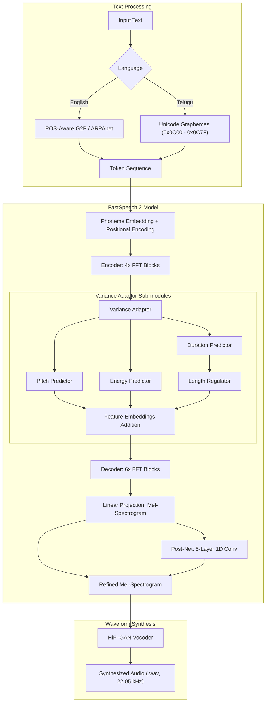

# FastSpeech 2: Non-Autoregressive Text-to-Speech Synthesis
### Multi-Lingual Neural TTS for English (Svarah) and Telugu (IndicTTS)

---

## Table of Contents
1. [Project Overview](#project-overview)
2. [Key Architecture & Features](#key-architecture--features)
3. [System Architecture Diagram](#system-architecture-diagram)
4. [Datasets & Data Processing](#datasets--data-processing)
5. [Repository Structure](#repository-structure)
6. [Environment Setup & Installation](#environment-setup--installation)
7. [Workflow & Usage](#workflow--usage)
   - [Data Preparation & Forced Alignment](#1-data-preparation--forced-alignment)
   - [Feature Preprocessing](#2-feature-preprocessing)
   - [Model Training](#3-model-training)
   - [Inference & Speech Synthesis](#4-inference--speech-synthesis)
   - [Prosody & Variance Controllability](#5-prosody--variance-controllability)
8. [Experimental Results & Evaluation](#experimental-results--evaluation)
   - [Training & Validation Loss Convergence](#training--validation-loss-convergence)
   - [Speech Synthesis Evaluation (5 Test Sentences per Language)](#speech-synthesis-evaluation)
   - [Variance Adaptor Analysis](#variance-adaptor-analysis)
9. [Project Deliverables](#project-deliverables)
10. [References](#references)

---

## Project Overview

This repository provides an end-to-end neural text-to-speech (TTS) implementation using the **FastSpeech 2** architecture for two distinct languages:
- **English**: Trained on the **Svarah** corpus (Indian-accented English speech).
- **Telugu**: Trained on the **IndicTTS Telugu** dataset.

Unlike traditional autoregressive models (such as Tacotron 2) which synthesize speech sequentially frame-by-frame and suffer from exposure bias and slow inference speeds, FastSpeech 2 is **fully non-autoregressive**. It generates mel-spectrograms entirely in parallel and leverages a **Variance Adaptor** to predict phone durations, fundamental frequency (pitch), and energy contours, yielding natural prosody and precise inference-time controllability.

---

## Key Architecture & Features

1. **Non-Autoregressive Generation**: Parallel mel-spectrogram generation achieves synthesis orders of magnitude faster than real time.
2. **Variance Adaptor**:
   - **Duration Predictor & Length Regulator**: Estimates phoneme durations in the log domain and expands hidden states accordingly.
   - **Pitch Predictor**: Estimates phoneme-level fundamental frequency ($F_0$) with linear quantization into 256 bins.
   - **Energy Predictor**: Predicts frame-level/phoneme-level $L_2$-norm of STFT magnitudes quantized into 256 bins.
3. **Feed-Forward Transformer (FFT) Blocks**:
   - Multi-head self-attention mechanisms with 1D convolutional feed-forward networks for both the encoder (4 layers, 2 heads) and decoder (6 layers, 2 heads).
4. **Tacotron-2 Styled Post-Net**:
   - A 5-layer 1D convolutional residual network (512 hidden channels) to refine generated mel-spectrograms.
5. **HiFi-GAN Neural Vocoder**:
   - Converts 80-channel mel-spectrograms into 22.05 kHz time-domain speech waveforms.
6. **Inference Controllability**:
   - Real-time manipulation of speaking rate (duration), pitch, and vocal energy by tuning variance control scaling factors.

---

## System Architecture Diagram



---

## Datasets & Data Processing

### Dataset Statistics

| Language | Dataset Source | Training Samples | Validation Samples | Training Hours | Validation Hours | Total Hours |
| :--- | :--- | :---: | :---: | :---: | :---: | :---: |
| **English** | Svarah | 3,380 | 691 | 4.7052 hrs | 0.9682 hrs | ~5.67 hrs |
| **Telugu** | IndicTTS Telugu | 2,613 | 525 | 5.0021 hrs | 1.0023 hrs | ~6.00 hrs |

### Phoneme & Alignment Pipeline

1. **Forced Alignment (MFA)**:
   - **Montreal Forced Aligner (MFA)** is utilized to extract phone-to-audio alignments (`TextGrid` files), establishing exact phoneme boundaries and durations.
2. **Text Representation**:
   - **English**: Uses a POS-aware G2P model converting raw text into ARPAbet phoneme sequences, disambiguating homographs (e.g., *conduct* noun vs. verb), numbers, and out-of-vocabulary terms.
   - **Telugu**: Direct grapheme-level tokenization mapping UTF-8 Unicode characters (`0x0C00`–`0x0C7F`) and numerical digits to alignment units matching the MFA acoustic dictionary.
3. **Acoustic Audio Parameters**:
   - Sampling rate: **22,050 Hz**
   - STFT window length: **1024**
   - STFT hop length: **256**
   - Mel-filter channels: **80** ($f_{min} = 0\text{ Hz}$, $f_{max} = 8000\text{ Hz}$)

---

## Repository Structure

```
project/
├── English/                          # Complete English pipeline
│   ├── checkpoints/
│   │   └── 40000.pth.tar             # Trained English model checkpoint (step 40k)
│   ├── config/                       # Preprocessing, model, and training YAMLs
│   ├── data_split/
│   │   └── English_split.json        # Exact train/validation utterance partition
│   ├── hifigan/                      # HiFi-GAN vocoder models & weights
│   ├── inference_stats/              # Normalization statistics (stats.json, speakers.json)
│   ├── lexicon/                      # Lexicon dictionary files
│   ├── logs/                         # Training and validation step logs
│   ├── model/                        # FastSpeech 2 network, loss, optimizer
│   ├── preprocessor/                 # Feature extraction & alignment parsers
│   ├── text/                         # Text tokenization, cleaners, symbols
│   ├── transformer/                  # Transformer FFT layers & attention modules
│   ├── utils/                        # Model loading and synthesis helpers
│   ├── config.yaml                   # Top-level language configuration
│   ├── dataset.py                    # PyTorch Dataset & dynamic batch collation
│   ├── evaluate.py                   # Checkpoint evaluation script
│   ├── inference.py                  # End-to-end evaluation & plotting pipeline
│   ├── prepare_align.py              # MFA preparation script
│   ├── preprocess.py                 # Feature extraction pipeline
│   ├── requirements.txt              # Language package dependencies
│   ├── synthesize.py                 # Multi-mode audio synthesis CLI
│   └── train.py                      # FastSpeech 2 training loop
│
├── Telugu/                           # Complete Telugu pipeline (matching English structure)
│   ├── checkpoints/
│   │   └── 40000.pth.tar             # Trained Telugu model checkpoint (step 40k)
│   ├── config/                       # Language configurations
│   ├── data_split/
│   │   └── Telugu_split.json         # Exact train/validation utterance partition
│   ├── hifigan/                      # HiFi-GAN vocoder models & weights
│   ├── inference_stats/              # Normalization statistics
│   ├── logs/                         # Training and validation step logs
│   ├── model/
│   ├── preprocessor/
│   ├── text/
│   ├── transformer/
│   ├── utils/
│   ├── config.yaml
│   ├── dataset.py
│   ├── evaluate.py
│   ├── inference.py
│   ├── prepare_align.py
│   ├── preprocess.py
│   ├── requirements.txt
│   ├── synthesize.py
│   └── train.py
│
├── Report/
│   └── Technical_Report.pdf          # Final project technical report
│
├── Results/                          # Submission evaluation results
│   ├── English/
│   │   ├── test_generated_audios/    # 5 synthesized test WAV audio files
│   │   ├── variance_adaptor_plots/   # Per-test duration, pitch, energy plots
│   │   ├── training_loss.png         # English training loss curve
│   │   └── validation_loss.png       # English validation loss curve
│   └── Telugu/
│       ├── test_generated_audios/    # 5 synthesized test WAV audio files
│       ├── variance_adaptor_plots/   # Per-test duration, pitch, energy plots
│       ├── training_loss.png         # Telugu training loss curve
│       └── validation_loss.png       # Telugu validation loss curve
│
├── README.md
└── requirements.txt                  # Unified dependencies file
```

---

## Environment Setup & Installation

### 1. Prerequisites
- Python 3.8, 3.9, or 3.10
- PyTorch 1.7.0+ (CUDA-enabled recommended for GPU acceleration)
- FFmpeg (for audio reading/writing)

### 2. Dependency Installation
Install dependencies via the unified requirements file:
```bash
pip install -r requirements.txt
```

Alternatively, install dependencies for an individual language environment:
```bash
cd English
pip install -r requirements.txt
```

### 3. Vocoder Setup
HiFi-GAN vocoder checkpoints are included in the repository:
- `English/hifigan/generator_universal.pth.tar`
- If zipped, extract `generator_universal.pth.tar.zip` directly into the `hifigan/` directory.

---

## Workflow & Usage

### 1. Data Preparation & Forced Alignment
To run Montreal Forced Aligner (MFA) alignment:
```bash
python prepare_align.py config/English/preprocess.yaml
```
Run MFA with the provided lexicon and acoustic model to produce `TextGrid` alignment files into `preprocessed_data/<Language>/TextGrid/`.

### 2. Feature Preprocessing
Extract pitch ($F_0$), energy contours, duration targets, and mel-spectrograms:
```bash
python preprocess.py config/English/preprocess.yaml
```

### 3. Model Training
To train the FastSpeech 2 model from scratch or resume:
```bash
python train.py -p config/English/preprocess.yaml -m config/English/model.yaml -t config/English/train.yaml
```
- Multi-GPU and gradient accumulation are supported via `optimizer.grad_acc_step`.
- TensorBoard logs are written to `output/log/<dataset>/`.

### 4. Inference & Speech Synthesis

#### Single Sentence Synthesis:
Synthesize speech for a custom sentence using the trained 40,000-step checkpoint:
```bash
python synthesize.py \
  --text "Hello, how are you today?" \
  --restore_step 40000 \
  --mode single \
  -p config/English/preprocess.yaml \
  -m config/English/model.yaml \
  -t config/English/train.yaml
```
The output WAV will be stored in `output/result/`.

#### Batch Synthesis:
Synthesize a list of sentences from a text file:
```bash
python synthesize.py \
  --source preprocessed_data/English/val.txt \
  --restore_step 40000 \
  --mode batch \
  -p config/English/preprocess.yaml \
  -m config/English/model.yaml \
  -t config/English/train.yaml
```

#### Automated Evaluation & Plot Generation:
To run the automated suite that synthesizes the benchmark test sentences, plots loss curves, and generates variance adaptor analysis graphs:
```bash
python inference.py --out ../Results/English --restore_step 40000
```

### 5. Prosody & Variance Controllability

FastSpeech 2 allows independent control over duration (speaking speed), pitch, and energy during synthesis:
- `--duration_control <float>`: Scales speaking speed ($< 1.0$ faster, $> 1.0$ slower).
- `--pitch_control <float>`: Scales voice pitch ($< 1.0$ lower pitch, $> 1.0$ higher pitch).
- `--energy_control <float>`: Scales voice loudness ($< 1.0$ softer, $> 1.0$ louder).

Example (speaking 20% faster with 20% higher pitch):
```bash
python synthesize.py \
  --text "The researchers will conduct an experiment." \
  --restore_step 40000 \
  --mode single \
  -p config/English/preprocess.yaml \
  -m config/English/model.yaml \
  -t config/English/train.yaml \
  --duration_control 0.8 \
  --pitch_control 1.2
```

---

## Experimental Results & Evaluation

### Training & Validation Loss Convergence

Both models were trained up to **40,000 steps** using the Adam optimizer with scheduled learning rate annealing and gradient clipping.

#### Loss Formulation:
$$\mathcal{L}_{\text{total}} = \mathcal{L}_{\text{mel}} + \mathcal{L}_{\text{postnet}} + \mathcal{L}_{\text{duration}} + \mathcal{L}_{\text{pitch}} + \mathcal{L}_{\text{energy}}$$

- **Mel Loss ($\mathcal{L}_{\text{mel}}$)**: MAE between predicted and ground-truth mel-spectrograms.
- **Post-Net Loss ($\mathcal{L}_{\text{postnet}}$)**: MAE of the post-net refined mel-spectrogram.
- **Duration Loss ($\mathcal{L}_{\text{duration}}$)**: MSE between predicted and MFA ground-truth log durations.
- **Pitch & Energy Losses**: MSE between predicted and extracted phoneme-level values.

Both English and Telugu models exhibit smooth convergence:
- Total training loss decreases from $> 9.5$ down to $\sim 0.95$.
- Total validation loss stabilizes around $4.0$ with no signs of severe overfitting.

The separate loss curves are available in the repository:
- `Results/English/training_loss.png`
- `Results/English/validation_loss.png`
- `Results/Telugu/training_loss.png`
- `Results/Telugu/validation_loss.png`

---

### Speech Synthesis Evaluation

Five benchmark test sentences were evaluated for each language. The synthesized audio outputs are preserved in `Results/<Language>/test_generated_audios/`:

#### English Test Sentences (Svarah Model)

| Test ID | Sentence Text | Audio File | Observations |
| :--- | :--- | :--- | :--- |
| **English Test 1** | *"Hello, how are you today?"* | `English_Test_1.wav` | Clear, natural conversational prosody; crisp intonation. |
| **English Test 2** | *"The researchers will conduct an experiment."* | `English_Test_2.wav` | Proper POS-aware stress on the verb *"conduct"*; natural flow. |
| **English Test 3** | *"Students learn new things every day."* | `English_Test_3.wav` | Smooth phoneme transitions with accurate duration pacing. |
| **English Test 4** | *"And they went off into the space when earth was burning up or being destroyed"* | `English_Test_4.wav` | Sustained synthesis over a complex sentence; stable rhythm. |
| **English Test 5** | *"Karnataka's expansive list of handmade artisanal products are impressive"* | `English_Test_5.wav` | Intelligible articulation of multi-syllabic regional and descriptive terms. |

#### Telugu Test Sentences (IndicTTS Telugu Model)

| Test ID | Sentence Text | Translation | Audio File |
| :--- | :--- | :--- | :--- |
| **Telugu Test 1** | *నమస్కారం, మీరు ఎలా ఉన్నారు?* | *"Hello, how are you?"* | `Telugu_Test_1.wav` |
| **Telugu Test 2** | *నేను బాగున్నాను* | *"I am fine."* | `Telugu_Test_2.wav` |
| **Telugu Test 3** | *ఈ రోజు చాలా మంచి రోజు.* | *"Today is a very good day."* | `Telugu_Test_3.wav` |
| **Telugu Test 4** | *విద్య మన జీవితంలో చాలా ముఖ్యం.* | *"Education is very important in our life."* | `Telugu_Test_4.wav` |
| **Telugu Test 5** | *మనమందరం కలిసి పని చేయాలి.* | *"We all need to work together."* | `Telugu_Test_5.wav` |

*Listening Check Summary*: The synthesized Telugu speech maintains clear phonetic intelligibility with natural syllable pacing. English synthesis exhibits the characteristic Indian English cadence present in the Svarah corpus.

---

### Variance Adaptor Analysis

For every test sentence, the Variance Adaptor outputs were analyzed across all phoneme positions:
- **Duration**: Predicted number of acoustic frames allocated per phoneme.
- **Pitch**: Predicted fundamental frequency contour across phoneme tokens.
- **Energy**: Predicted acoustic energy profile.

All variance plots are organized under:
- `Results/English/variance_adaptor_plots/`
  - `duration/`: `Test_1_duration.png` to `Test_5_duration.png`
  - `pitch/`: `Test_1_pitch.png` to `Test_5_pitch.png`
  - `energy/`: `Test_1_energy.png` to `Test_5_energy.png`
- `Results/Telugu/variance_adaptor_plots/`
  - `duration/`, `pitch/`, and `energy/` per test sentence.

> [!NOTE]
> Pitch and energy analysis curves represent normalized model-output feature units rather than uncalibrated physical measurements (Hz or dB).

---

## Project Deliverables

The submission consists of the complete verified repository:
1. **Source Code**: Python implementations for both languages stripped of extraneous comments and fully syntax-validated.
2. **Model Checkpoints**: Step 40,000 checkpoints (`40000.pth.tar`) for both English and Telugu.
3. **HiFi-GAN Vocoders**: Universal and LJSpeech neural vocoder models.
4. **Data Split Metadata**: `English_split.json` and `Telugu_split.json` documenting exact train/validation sample IDs.
5. **Logs**: Complete step-by-step training and validation loss logs.
6. **Result Audios**: 10 total 16-bit 22.05 kHz WAV files (5 English + 5 Telugu).
7. **Loss & Variance Plots**: 42 high-resolution analytical plots covering training curves and variance components.
8. **Technical Report**: Complete PDF report located at `Report/Technical_Report.pdf`.

---

## References

1. **FastSpeech 2**: Y. Ren, C. Hu, X. Tan, T. Qin, S. Zhao, Z. Zhao, T.-Y. Liu. *"FastSpeech 2: Fast and High-Quality End-to-End Text to Speech"*, ICLR 2021. [arXiv:2006.04558](https://arxiv.org/abs/2006.04558).
2. **HiFi-GAN**: J. Kong, J. Kim, J. Bae. *"HiFi-GAN: Generative Adversarial Networks for Efficient and High Fidelity Speech Synthesis"*, NeurIPS 2020. [arXiv:2010.05646](https://arxiv.org/abs/2010.05646).
3. **Montreal Forced Aligner**: M. McAuliffe, M. Socolof, S. Mihuc, M. Wagner, M. Sonderegger. *"Montreal Forced Aligner: trainable text-speech alignment using Kaldi"*, Interspeech 2017.
4. **Svarah Corpus**: Indian English Speech Corpus for TTS.
5. **IndicTTS**: Speech databases for Indian languages, IIT Madras.
